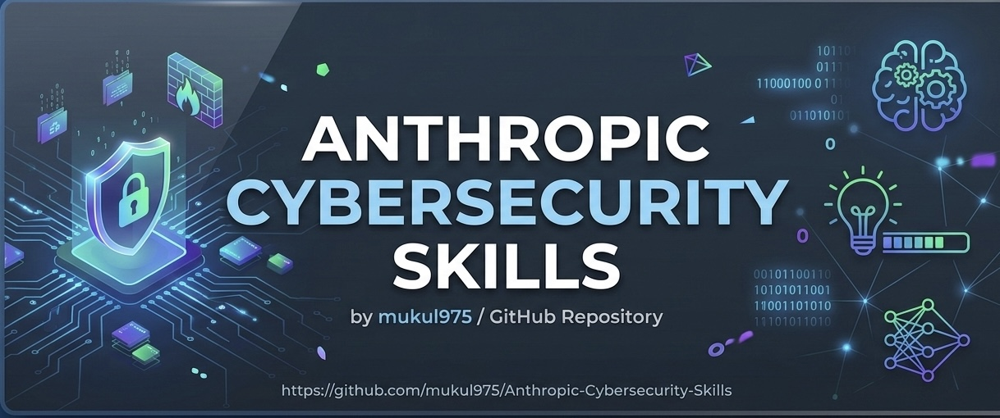

<p align="center">
  
</p>

<div align="center">

# Anthropic Cybersecurity Skills — Defensive-Only Fork

### No offensive or exploit code. Safe for learning, safe for authorized testing, safe to run in production.

[](CURATION_NOTES.md)
[](#whats-inside--32-security-domains)
[](TOOLS_SETUP_GUIDE.md)
[](LICENSE)
[](#six-frameworks-one-skill-library)
[](#whats-inside--32-security-domains)
[](https://agentskills.io)
[](CONTRIBUTING.md)

**712 defensive-only cybersecurity skills · every exploit, C2, and credential-cracking skill removed · nothing in the skill path that can run an attack**

Built for three things: **learning** security concepts hands-on, **authorized safe testing** in a lab, and **everyday use alongside production systems** without the risk of an agent reaching for offensive tooling it was never asked for.

[Get Started](#quick-start) · [Why This Fork](#why-this-fork) · [What's Inside](#whats-inside--32-security-domains) · [Frameworks](#six-frameworks-one-skill-library)

</div>

---

> ⚠️ **Community Project** — This is an independent, community-created project. Not affiliated with Anthropic PBC.
>
> 🛡️ **This is a defensive-only fork.** Every skill that could execute an exploit, run C2 infrastructure, crack credentials, or disrupt a live network has been removed — see [Why This Fork](#why-this-fork) below. The upstream project, [mukul975/anthropic-cybersecurity-skills](https://github.com/mukul975/anthropic-cybersecurity-skills), includes offensive/dual-use content for authorized red-team use; if that's what you need, use the upstream repo instead.

## Why This Fork

The upstream library is excellent, but it ships 818 skills side by side — detection playbooks next to live exploit code for named CVEs, credential-cracking tools, and full C2 framework operation guides. That's a reasonable choice for a general-purpose library, but it's a liability for:

- **Teams that just do defense** (SOC, threat hunting, forensics, compliance) and don't want exploit tooling sitting in their agent's skill path
- **Enterprises with AUP/compliance constraints** that can't have offensive security tooling in a dependency, even unused
- **Anyone building a product on top of this library** who needs to say with confidence "this cannot run an attack"

This fork removes exactly that risk, with the removal decision made transparent and auditable rather than just asserted:

| | Upstream | This fork |
|---|---|---|
| Total skills | 818 | 712 |
| Offensive/exploit/C2 skills | 106 included | **0** — fully removed, [full list here](REMOVED_SKILLS.txt) |
| Removal criteria documented | — | ✅ [CURATION_NOTES.md](CURATION_NOTES.md) — exact rules used, reviewable |
| Per-skill tool manifest | — | ✅ [tool_manifest.json](tool_manifest.json) — machine-readable, what each skill needs to actually run |
| Grouped tool setup guide | — | ✅ [TOOLS_SETUP_GUIDE.md](TOOLS_SETUP_GUIDE.md) — install/connect guidance by category (SIEM, EDR, forensics, threat-intel) |
| Safe for compliance-constrained environments | Requires manual filtering | ✅ out of the box |

If you need the removed skills for an authorized red-team engagement, the [upstream repo](https://github.com/mukul975/anthropic-cybersecurity-skills) has them, clearly licensed for that use.

⭐ **If this saved you from auditing 818 skills by hand, a star helps other defense-focused teams find it.**

## Give any AI agent the security skills of a senior analyst

A junior analyst knows which Volatility3 plugin to run on a suspicious memory dump, which Sigma rules catch Kerberoasting, and how to scope a cloud breach across three providers. **Your AI agent doesn't — unless you give it these skills.**

This repo contains **712 structured, defensive-only cybersecurity skills** spanning **32 security domains**, curated from the 818-skill upstream library by removing every exploit, C2, and credential-cracking skill (see [Why This Fork](#why-this-fork)). Each skill follows the [agentskills.io](https://agentskills.io) open standard.  The library maps across **six industry frameworks** — MITRE ATT&CK, NIST CSF 2.0, MITRE ATLAS, MITRE D3FEND, NIST AI RMF, and the MITRE Fight Fraud Framework (F3) — with each skill mapped to the frameworks **relevant to its type** (a forensics skill carries ATT&CK + CSF; an AI-security skill adds ATLAS and AI RMF). Every kept skill also ships a machine-readable tool manifest (see [tool_manifest.json](tool_manifest.json)). Clone it, point your agent at it, and your next security investigation gets expert-level guidance in seconds — with nothing in the skill path that can run an attack.

## Six frameworks, one skill library

Each skill maps to the frameworks that fit its subject — ATT&CK and NIST CSF are near-universal, while ATLAS, AI RMF, D3FEND, and F3 apply where they're relevant. **Framework coverage across this fork's 712 skills** (recomputed after curation, by scanning each kept skill's frontmatter): MITRE ATT&CK **700** · NIST CSF 2.0 **699** · MITRE D3FEND **112** · MITRE F3 **87** · NIST AI RMF **89** · MITRE ATLAS **86**.

| Framework | Version | Framework scope | What it maps |
|---|---|---|---|
| [MITRE ATT&CK](https://attack.mitre.org) | v19.1 | 15 tactics · Enterprise/Mobile/ICS | Adversary behaviors and TTPs |
| [NIST CSF 2.0](https://www.nist.gov/cyberframework) | 2.0 | 6 functions · 22 categories · 106 subcategories | Organizational security posture |
| [MITRE ATLAS](https://atlas.mitre.org) | 2026.07 | 101 techniques · 77 sub-techniques | AI/ML adversarial threats |
| [MITRE D3FEND](https://d3fend.mitre.org) | v1.4.0 | 270 techniques | Defensive countermeasures |
| [NIST AI RMF](https://airc.nist.gov/AI_RMF) | 1.0 | 4 functions (Govern/Map/Measure/Manage) | AI risk management |
| [MITRE F3 (Fight Fraud Framework)](https://ctid.mitre.org/fraud/) | v1.1 (2026-04-09) | 8 tactics · 123 techniques · 94 fraud-relevant skills | Cyber-enabled financial fraud TTPs |

**Example — each skill maps only to the frameworks relevant to it (one may hit all six, another just a couple):**

| Skill | ATT&CK | NIST CSF | ATLAS | D3FEND | AI RMF | F3 |
|---|---|---|---|---|---|---|
| `analyzing-network-traffic-of-malware` | T1071 | DE.CM | AML.T0047 | D3-NTA | MEASURE-2.6 | — |
| `detecting-business-email-compromise` | T1566 | DE.AE | — | — | — | F1005.006 · monetization |

### 🆕 MITRE Fight Fraud Framework (F3) — 87 fraud-relevant skills in this fork

[](https://ctid.mitre.org/fraud/)

The **[MITRE Fight Fraud Framework (F3)](https://ctid.mitre.org/fraud/)** was released **April 9, 2026** by MITRE's Center for Threat-Informed Defense (CTID), co-developed with JPMorganChase, Citigroup, Lloyds Banking Group, Standard Chartered, CrowdStrike, Verizon Business, FS-ISAC, and others. It is an ATT&CK-compatible TTP catalog for **cyber-enabled financial fraud** — filling the gap ATT&CK leaves after initial compromise.

F3 v1.1 adds **two fraud-specific tactics** that ATT&CK does not enumerate:
- **Positioning** (`FA0001`) — actions taken after access to collect/manipulate data and prepare the fraud (synthetic-identity seeding, account warming, beneficiary setup, SIM-swap pre-positioning, banking-session hijack).
- **Monetization** (`FA0002`) — converting stolen assets into usable funds (money-mule layering, APP fraud, crypto off-ramping, card cash-out, refund/chargeback abuse).

Fraud-specific techniques use `F1XXX` IDs (e.g. `F1005.003` Add Beneficiary, `F1025.003` Wire Transfer, `F1007` Adversary-in-the-Browser); reused ATT&CK techniques keep their `T1XXX` IDs. Mappings live in each skill's `mitre_f3:` frontmatter block — all 123 F3 v1.1 technique IDs were verified against the upstream STIX bundle. See [`docs/mitre-f3-mapping.md`](docs/mitre-f3-mapping.md) for the schema.

### MITRE ATT&CK v19.1 — 700/712 skills mapped in this fork

Every skill carries a `mitre_attack` frontmatter list, inherited unchanged from upstream's validation against **MITRE ATT&CK v19.1** using the official `mitreattack-python` library.

> ⚠️ The per-tactic skill-count breakdown below is carried over from the **upstream 817-skill count** and has not yet been recomputed against this fork's 712 skills (doing so needs the `mitreattack-python` technique→tactic mapping pipeline, which requires live access to the MITRE ATT&CK STIX data). Treat these counts as directional for now — PRs that regenerate this table against the curated skill set are welcome.

| Tactic | ID | Skills (upstream count, not yet re-verified for this fork) |
|--------|----|--------|
| Reconnaissance | TA0043 | 103 |
| Resource Development | TA0042 | 22 |
| Initial Access | TA0001 | 467 |
| Execution | TA0002 | 350 |
| Persistence | TA0003 | 444 |
| Privilege Escalation | TA0004 | 464 |
| Stealth | TA0005 | 442 |
| Defense Impairment | TA0112 | 92 |
| Credential Access | TA0006 | 202 |
| Discovery | TA0007 | 237 |
| Lateral Movement | TA0008 | 68 |
| Collection | TA0009 | 172 |
| Command and Control | TA0011 | 123 |
| Exfiltration | TA0010 | 82 |
| Impact | TA0040 | 50 |

## Quick start

```bash
# Option 1: npx (recommended)
npx skills add fatehMohamed14/anthropic-cybersecurity-skills-defensive

# Option 2: Git clone
git clone https://github.com/fatehMohamed14/anthropic-cybersecurity-skills-defensive.git
cd anthropic-cybersecurity-skills
```

Works immediately with Claude Code, GitHub Copilot, OpenAI Codex CLI, Cursor, Gemini CLI, and any [agentskills.io](https://agentskills.io)-compatible platform. Every skill loaded this way is defensive-only — see [Why This Fork](#why-this-fork).

## What's inside — 32 security domains

Recomputed directly from this fork's actual `skills/` folder (not carried over from upstream) — **Red Teaming and Penetration Testing no longer appear as domains**, because every skill that made up those two domains upstream was offensive-tier and removed. A few remaining skills that fell under those two domains but were purely detection/defense-oriented were reclassified into the closest defensive domain during curation.

| Domain | Skills | Key capabilities |
|---|---|---|
| Cloud Security | 65 | AWS, Azure, GCP hardening · CSPM · cloud forensics |
| Threat Hunting | 58 | Hypothesis-driven hunts · LOTL detection · EVTX hunting · fleet hunting |
| Threat Intelligence | 52 | STIX/TAXII · MISP · OpenCTI · feed integration · actor profiling |
| Digital Forensics | 41 | Disk imaging · memory forensics · Hayabusa/KAPE/Plaso timelines |
| Malware Analysis | 39 | Static/dynamic analysis · reverse engineering · sandboxing |
| SOC Operations | 35 | Playbooks · escalation workflows · Graph-log detection · tabletop exercises |
| Identity & Access Management | 37 | Entra ID/ROADtools · PAM · zero trust identity |
| Container Security | 33 | K8s RBAC · image scanning · Falco |
| Network Security | 33 | IDS/IPS · firewall rules · VLAN segmentation · traffic analysis |
| OT/ICS Security | 29 | Modbus · DNP3 · IEC 62443 · historian defense · SCADA |
| Security Operations | 27 | SIEM correlation · log analysis · alert triage |
| Incident Response | 26 | Breach containment · ransomware response · IR playbooks |
| Vulnerability Management | 24 | Nessus · scanning workflows · patch prioritization · CVSS |
| Web Application Security | 25 | OWASP Top 10 · SQLi/XSS/SSRF detection · WAF tuning |
| API Security | 21 | GraphQL · REST · OWASP API Top 10 |
| DevSecOps | 18 | CI/CD security · Trivy IaC/image scanning · code signing |
| Zero Trust Architecture | 18 | BeyondCorp · CISA maturity model · microsegmentation |
| Endpoint Security | 17 | EDR · LOTL detection · fileless malware · persistence hunting |
| Phishing Defense | 16 | Email authentication · BEC detection · phishing IR · social-engineering defense |
| Cryptography | 15 | TLS · Ed25519 · post-quantum migration · key management |
| AI Security | 14 | LLM red-teaming detection (garak/PyRIT) · prompt-injection detection · MCP/agentic security · guardrails |
| Ransomware Defense | 13 | Precursor detection · response · recovery · encryption analysis |
| Mobile Security | 11 | Android/iOS analysis · MDM forensics |
| Compliance & Governance | 11 | NIST 800-30/RMF · CMMC · HIPAA · TPRM · CIS benchmarks |
| Supply Chain Security | 8 | SBOMs · dependency confusion · malicious-package triage · SLSA/Sigstore |
| Threat Detection | 7 | Credential-dumping detection · golden-ticket/pass-the-ticket detection · LOLBAS · UEBA insider signals |
| Hardware & Firmware Security | 6 | CHIPSEC/UEFI audit · TPM attestation · bootkit hunting |
| Deception Technology | 6 | Honeytokens · canarytokens · breach detection |
| Blockchain Security | 2 | Ethereum smart-contract vulnerability detection · Foundry audit workflows |
| Wireless Security | 2 | Bluetooth Low Energy attack detection · BLE security assessment |
| Privacy Compliance | 2 | GDPR data-subject access requests · privacy impact assessments |
| Data Protection | 1 | Data loss prevention with Microsoft Purview |

*712 skills across 32 domains. Counts come from each skill's `subdomain` frontmatter field, recomputed from this fork's own `skills/` folder.*

## How AI agents use these skills

Each skill costs **~30 tokens to scan** (frontmatter only)  and **500–2,000 tokens to fully load** (complete workflow). This progressive disclosure architecture lets agents search all 712 skills in a single pass without blowing context windows. 

```
User prompt: "Analyze this memory dump for signs of credential theft"

Agent's internal process:

  1. Scans 712 skill frontmatters (~30 tokens each)
     → identifies 12 relevant skills by matching tags, description, domain

  2. Loads top 3 matches:
     • performing-memory-forensics-with-volatility3
     • hunting-for-credential-dumping-lsass
     • analyzing-windows-event-logs-for-credential-access

  3. Executes the structured Workflow section step-by-step
     → runs Volatility3 plugins, checks LSASS access patterns,
        correlates with event log evidence

  4. Validates results using the Verification section
     → confirms IOCs, maps findings to ATT&CK T1003 (Credential Dumping)
```

**Without these skills**, the agent guesses at tool commands and misses critical steps. **With them**, it follows the same playbook a senior DFIR analyst would use. 

## Skill anatomy

Every skill follows a consistent directory structure:

```
skills/performing-memory-forensics-with-volatility3/
├── SKILL.md              ← Skill definition (YAML frontmatter + Markdown body)
├── references/
│   ├── standards.md      ← MITRE ATT&CK, ATLAS, D3FEND, NIST mappings
│   └── workflows.md      ← Deep technical procedure reference
├── scripts/
│   └── process.py        ← Working helper scripts
└── assets/
    └── template.md       ← Filled-in checklists and report templates
```


### YAML frontmatter (real example)

```yaml
---
name: performing-memory-forensics-with-volatility3
description: >-
  Analyze memory dumps to extract running processes, network connections,
  injected code, and malware artifacts using the Volatility3 framework.
domain: cybersecurity
subdomain: digital-forensics
tags: [forensics, memory-analysis, volatility3, incident-response, dfir]
atlas_techniques: [AML.T0047]
d3fend_techniques: [D3-MA, D3-PSMD]
nist_ai_rmf: [MEASURE-2.6]
nist_csf: [DE.CM-01, RS.AN-03]
version: "1.2"
author: mukul975
license: Apache-2.0
---
```


### Markdown body sections

```markdown
## When to Use
Trigger conditions — when should an AI agent activate this skill?

## Prerequisites
Required tools, access levels, and environment setup.

## Workflow
Step-by-step execution guide with specific commands and decision points.

## Verification
How to confirm the skill was executed successfully.
```

Frontmatter fields: `name` (kebab-case, 1–64 chars), `description` (keyword-rich for agent discovery), `domain`, `subdomain`, `tags`,  `atlas_techniques` (MITRE ATLAS IDs), `d3fend_techniques` (MITRE D3FEND IDs), `nist_ai_rmf` (NIST AI RMF references), `nist_csf` (NIST CSF 2.0 categories).  MITRE ATT&CK technique mappings are documented in each skill's `references/standards.md` file and in the ATT&CK Navigator layer included with releases. 

<details>
<summary><strong>📊 MITRE ATT&CK Enterprise coverage — all 15 tactics</strong></summary>

&nbsp;

| Tactic | ID | Coverage | Key skills |
|---|---|---|---|
| Reconnaissance | TA0043 | Strong | OSINT, subdomain enumeration, DNS recon |
| Resource Development | TA0042 | Moderate | Phishing infrastructure, C2 setup detection |
| Initial Access | TA0001 | Strong | Phishing simulation, exploit detection, forced browsing |
| Execution | TA0002 | Strong | PowerShell analysis, fileless malware, script block logging |
| Persistence | TA0003 | Strong | Scheduled tasks, registry, service accounts, LOTL |
| Privilege Escalation | TA0004 | Strong | Kerberoasting, AD attacks, cloud privilege escalation |
| Stealth | TA0005 | Strong | Obfuscation, rootkit analysis, evasion detection |
| Defense Impairment | TA0112 | Moderate | Impair Defenses (T1562), log/indicator removal, EDR tampering |
| Credential Access | TA0006 | Strong | Mimikatz detection, pass-the-hash, credential dumping |
| Discovery | TA0007 | Moderate | BloodHound, AD enumeration, network scanning |
| Lateral Movement | TA0008 | Strong | SMB exploits, lateral movement detection with Splunk |
| Collection | TA0009 | Moderate | Email forensics, data staging detection |
| Command and Control | TA0011 | Strong | C2 beaconing, DNS tunneling, Cobalt Strike analysis |
| Exfiltration | TA0010 | Strong | DNS exfiltration, DLP controls, data loss detection |
| Impact | TA0040 | Strong | Ransomware defense, encryption analysis, recovery |

An **ATT&CK Navigator layer file** is included in the [v1.0.0 release assets](https://github.com/mukul975/Anthropic-Cybersecurity-Skills/releases/tag/v1.0.0) for visual coverage mapping. 

> **Note:** ATT&CK v19 lands April 28, 2026 — splitting Defense Evasion (TA0005) into two new tactics: *Stealth* and *Impair Defenses*.  Skill mappings will be updated in a forthcoming release.

</details>

<details>
<summary><strong>📊 NIST CSF 2.0 alignment — all 6 functions</strong></summary>

&nbsp;

| Function | Skills | Examples |
|---|---|---|
| **Govern (GV)** | 30+ | Risk strategy, policy frameworks, roles & responsibilities |
| **Identify (ID)** | 120+ | Asset discovery, threat landscape assessment, risk analysis |
| **Protect (PR)** | 150+ | IAM hardening, WAF rules, zero trust, encryption |
| **Detect (DE)** | 200+ | Threat hunting, SIEM correlation, anomaly detection |
| **Respond (RS)** | 160+ | Incident response, forensics, breach containment |
| **Recover (RC)** | 40+ | Ransomware recovery, BCP, disaster recovery |

NIST CSF 2.0 (February 2024) added the **Govern** function  and expanded scope from critical infrastructure to all organizations.  Skill mappings align to all 22 categories and reference 106 subcategories. 

</details>

<details>
<summary><strong>📊 Framework deep dive — ATLAS, D3FEND, AI RMF</strong></summary>

&nbsp;

### MITRE ATLAS 2026.07 — AI/ML adversarial threats
ATLAS maps adversarial tactics, techniques, and case studies specific to AI and machine learning systems. Release 2026.07 covers **101 techniques and 77 sub-techniques** including agentic AI attack vectors added in late 2025: AI agent context poisoning, tool invocation abuse, MCP server compromises, and malicious agent deployment.  Skills mapped to ATLAS help agents identify and defend against threats to ML pipelines, model weights, inference APIs, and autonomous workflows. 

### MITRE D3FEND v1.4.0 — Defensive countermeasures
D3FEND is an NSA-funded knowledge graph of **270 defensive techniques** organized across 7 tactical categories: Model, Harden, Detect, Isolate, Deceive, Evict, and Restore.  Built on OWL 2 ontology, it uses a shared Digital Artifact layer to bidirectionally map defensive countermeasures to ATT&CK offensive techniques.  Skills tagged with D3FEND identifiers let agents recommend specific countermeasures for detected threats.

### NIST AI RMF 1.0 + GenAI Profile (AI 600-1)
The AI Risk Management Framework defines 4 core functions — Govern, Map, Measure, Manage — with **72 subcategories** for trustworthy AI development.  The GenAI Profile (AI 600-1, July 2024) adds **12 risk categories** specific to generative AI, from confabulation and data privacy to prompt injection and supply chain risks.  Colorado's AI Act (effective February 2026) provides a **legal safe harbor** for organizations complying with NIST AI RMF, making these mappings directly relevant to regulatory compliance.

</details>

## Compatible platforms

**AI code assistants**
Claude Code (Anthropic) · GitHub Copilot (Microsoft) · Cursor · Windsurf · Cline · Aider · Continue · Roo Code · Amazon Q Developer · Tabnine · Sourcegraph Cody · JetBrains AI 

**CLI agents**
OpenAI Codex CLI · Gemini CLI (Google) 

**Autonomous agents**
Devin · Replit Agent · SWE-agent · OpenHands 

**Agent frameworks & SDKs**
LangChain · CrewAI · AutoGen · Semantic Kernel · Haystack · Vercel AI SDK · Any MCP-compatible agent 

All platforms that support the [agentskills.io](https://agentskills.io) standard can load these skills with zero configuration. 

## Releases

| Version | Date | Highlights |
|---|---|---|
| [v1.0.0](https://github.com/mukul975/Anthropic-Cybersecurity-Skills/releases/tag/v1.0.0) | March 11, 2026 | 734 skills · 26 domains · MITRE ATT&CK + NIST CSF 2.0 mapping · ATT&CK Navigator layer |

Skills have continued to grow on upstream `main` since v1.0.0 — the upstream library now contains **818 skills** with **6-framework mapping**  (MITRE ATLAS, D3FEND, NIST AI RMF, and the MITRE Fight Fraud Framework added post-release).  Check [upstream Releases](https://github.com/mukul975/anthropic-cybersecurity-skills/releases) for the latest tagged upstream version.

**This fork** is a curated snapshot of that library: 106 offensive/exploit/C2 skills removed (712 remain), plus a per-skill tool manifest and setup guide added. See [CURATION_NOTES.md](CURATION_NOTES.md) for exactly what changed and why.

## Contributing to this fork

This fork's own scope is narrow and separate from upstream's: keeping the defensive-only curation accurate, and keeping the tool manifest current.

**Help with this fork specifically:**
- Found a skill in `skills/` that's actually offensive/dual-use and slipped through the filter? Open an issue or PR removing it, citing the skill name.
- Found a defensive skill on [REMOVED_SKILLS.txt](REMOVED_SKILLS.txt) that was over-filtered (a false positive)? Open an issue — see the borderline cases already flagged in [CURATION_NOTES.md](CURATION_NOTES.md).
- Know a tool missing from a skill's entry in [tool_manifest.json](tool_manifest.json) or [TOOLS_SETUP_GUIDE.md](TOOLS_SETUP_GUIDE.md)? PRs welcome.

**Want to add a brand-new skill, or improve an existing one's workflow?** That belongs upstream — read [SCOPE.md](SCOPE.md) and upstream's [CONTRIBUTING.md](https://github.com/mukul975/anthropic-cybersecurity-skills/blob/main/CONTRIBUTING.md), submit it to [mukul975/anthropic-cybersecurity-skills](https://github.com/mukul975/anthropic-cybersecurity-skills), and it'll be picked up into this fork on the next sync.

This project follows the [Contributor Covenant](https://www.contributor-covenant.org/). By participating, you agree to uphold this code.

## Credit

All 712 skills in this fork were written by the contributors of the upstream [mukul975/anthropic-cybersecurity-skills](https://github.com/mukul975/anthropic-cybersecurity-skills) project — see [its contributor graph](https://github.com/mukul975/anthropic-cybersecurity-skills/graphs/contributors) for full credit. This fork's own contribution is the curation (removal list + rationale) and the tool manifest.

## Community

🔒 [Security Policy](SECURITY.md) — Responsible disclosure process
💬 For upstream skill-content discussions, see [upstream Discussions](https://github.com/mukul975/anthropic-cybersecurity-skills/discussions)

## Citation

If you use the **underlying skill content** in research or publications, cite the upstream project:

```bibtex
@software{anthropic_cybersecurity_skills,
  author       = {Jangra, Mahipal},
  title        = {Anthropic Cybersecurity Skills},
  year         = {2026},
  url          = {https://github.com/mukul975/anthropic-cybersecurity-skills},
  license      = {Apache-2.0},
  note         = {818 structured cybersecurity skills for AI agents,
                  mapped to MITRE ATT\&CK, NIST CSF 2.0, MITRE ATLAS,
                  MITRE D3FEND, and NIST AI RMF}
}
```

If you specifically use **this defensive-only curation and tool manifest**, you can additionally cite this fork:

```bibtex
@software{anthropic_cybersecurity_skills_defensive_fork,
  title        = {Anthropic Cybersecurity Skills — Defensive-Only Fork},
  year         = {2026},
  url          = {https://github.com/fatehMohamed14/anthropic-cybersecurity-skills-defensive},
  license      = {Apache-2.0},
  note         = {712 defensive-only cybersecurity skills, curated from the upstream
                  818-skill library with offensive/exploit/C2 content removed,
                  plus a machine-readable per-skill tool manifest}
}
```

## License

This project is licensed under the [Apache License 2.0](LICENSE), inherited from upstream. You are free to use, modify, and distribute these skills in both personal and commercial projects. 

---

<div align="center">

**If a defensive-only, audit-ready skill library saves your team time, consider giving it a ⭐**

[⭐ Star this fork](https://github.com/fatehMohamed14/anthropic-cybersecurity-skills-defensive/stargazers) · [🍴 Fork this fork](https://github.com/fatehMohamed14/anthropic-cybersecurity-skills-defensive/fork) · [📄 Why this fork exists](#why-this-fork) · [⭐ Star upstream too](https://github.com/mukul975/anthropic-cybersecurity-skills/stargazers)

Skill content by the upstream community, curated by [@fatehMohamed14](https://github.com/fatehMohamed14). Not affiliated with Anthropic PBC.

</div>
